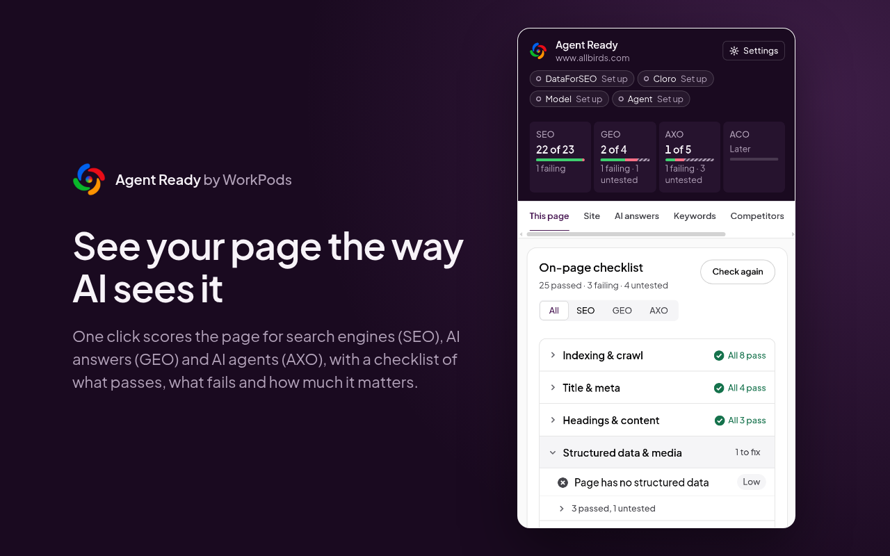
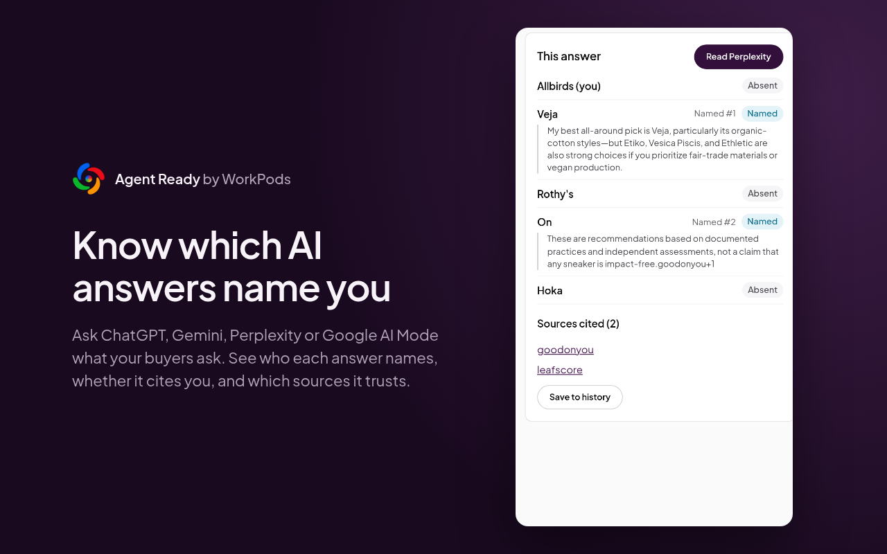
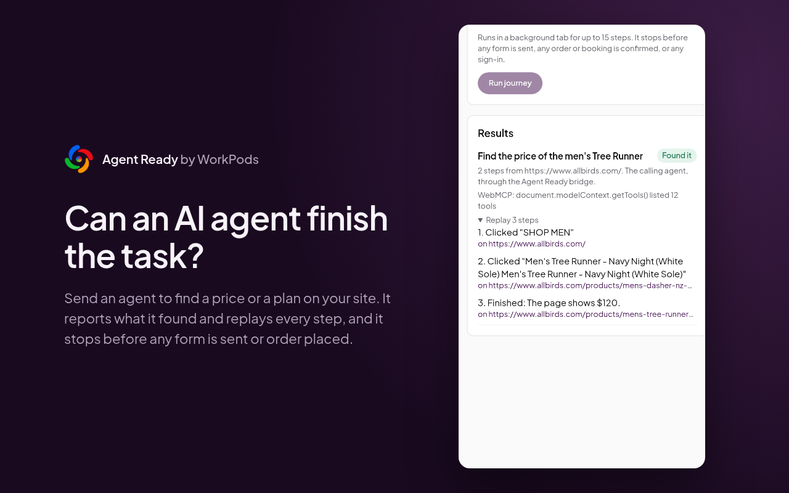
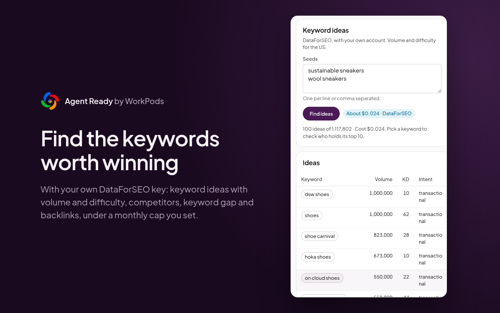
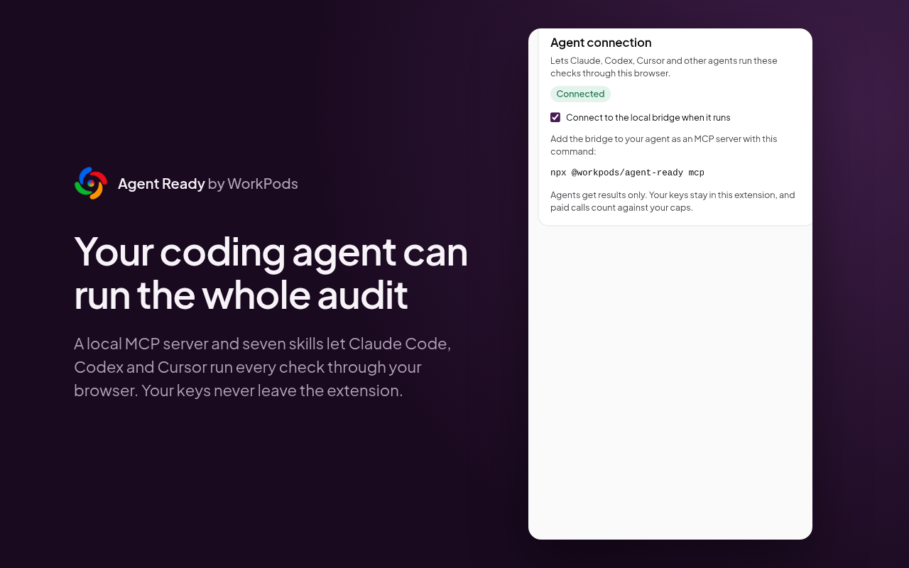

# Agent Ready

See your site the way search engines, AI answers and AI agents see it, and fix what stops them.



Agent Ready is a free, open-source Chrome extension, with a local MCP server and a set of skills
for coding agents. It checks any page for three things:

- **SEO:** can search engines crawl, index and understand the page?
- **GEO:** can AI answer engines such as ChatGPT, Gemini and Perplexity reach, read and cite it?
- **AXO:** can an AI agent use the site? Can it name the controls, call the forms as tools and
  finish a task like finding a price?

It needs no account, sends nothing to us and has no telemetry. The checks come from the audits
[WorkPods](https://workpods.ai) runs for its clients, with the same ids, severities and wording.

<p align="center">
  
  
  
  
</p>
<p align="center"><sub>Real results for allbirds.com, used as an example only. More in <a href="docs/using-the-extension.md">Using the extension</a>.</sub></p>

## What it does

**Free, with no keys:**

- Checks the page you are on. Each check passes, fails, partly passes or is untested, and a
  failure carries a severity. **Show on page** marks the element, and **Copy fix** copies a prompt
  for your coding agent.
- **See as AI** puts the raw HTML that AI crawlers read next to the page people see: word counts,
  schema types and text. If your copy only appears after JavaScript runs, it shows here.
- Reads robots.txt, sitemaps, llms.txt and agent manifests, and says which AI crawlers may fetch
  the site.
- Crawls up to 200 pages, one at a time and within robots.txt, to find broken links, duplicates,
  orphan pages, soft 404s and hreflang errors.
- Compares your page with a competitor's, check by check.
- Reads an AI answer open in your tab (ChatGPT, Gemini, Claude, Perplexity, Google AI Mode or an
  AI Overview) and marks which brands it names and which sites it cites.
- Runs a panel of buyer prompts in **Assist** mode: the extension types each prompt, you press
  Enter, and it scores the answer.
- Sends an AI agent through a task on your site, such as finding a price. The agent stops before a
  form is sent, an order is placed or anyone signs in.

**With your own keys**, kept encrypted on your device under a monthly cap you set:

- **DataForSEO:** keyword ideas with volume and difficulty, competitor discovery, keyword gap,
  backlinks and link gap.
- **Cloro:** prompt panels that run unattended on ChatGPT, Gemini and Google AI Mode.
- **Anthropic, OpenAI or Gemini:** the model that runs agent journeys from the panel. Your coding
  agent can run journeys instead, through the bridge.

**From your coding agent:** Claude Code, Codex, Cursor and other MCP clients can run every check
through the local bridge. The skills turn the results into an audit report, and then into code
changes in your repository.

## Get started

Install [Agent Ready from the Chrome Web Store](https://chromewebstore.google.com/detail/agent-ready-by-workpods/lemechdbpooffhgeidkmefoppjjilanb).

The npm bridge package is not published yet. Until it is, use the
[source-install instructions](docs/agents-and-skills.md#before-the-npm-release) for agent and CLI
commands. [TESTING.md](TESTING.md) covers unpacked builds for development and release testing.

1. [Install the extension](https://chromewebstore.google.com/detail/agent-ready-by-workpods/lemechdbpooffhgeidkmefoppjjilanb),
   open its side panel and click **Check this page**:
   [Getting started](docs/getting-started.md).
2. Learn what each tab does: [Using the extension](docs/using-the-extension.md).
3. Connect your coding agent and add the skills: [Agents and skills](docs/agents-and-skills.md).

```bash
# Give Claude Code the Agent Ready tools, then turn on Agent connection in the extension's settings
claude mcp add agent-ready -- npx -y @workpods/agent-ready mcp

# Check a page from a terminal or a CI job, with no browser
npx @workpods/agent-ready check https://example.com --fail-on high
```

## Documentation

| Guide                                                      | Read it to                                                                   |
| ---------------------------------------------------------- | ---------------------------------------------------------------------------- |
| [Getting started](docs/getting-started.md)                 | Install the extension and run your first check                               |
| [Using the extension](docs/using-the-extension.md)         | Work through each tab, from This page to Journeys                            |
| [How the checks work](docs/how-checks-work.md)             | Read a score, a status and a severity, and know what "untested" means        |
| [Keys and spending](docs/keys-and-spending.md)             | Set up the vault, add DataForSEO, Cloro or a model key, and cap what you pay |
| [Agents and skills](docs/agents-and-skills.md)             | Connect Claude Code, Codex or Cursor, and use the seven skills               |
| [Command line and CI](docs/command-line.md)                | Check pages from a terminal and fail a build when a page regresses           |
| [Privacy and permissions](docs/privacy-and-permissions.md) | See what is stored, what leaves your device and why each permission is asked |

## How it is built

```text
packages/core/    The checks, in plain TypeScript. They take a parsed page, headers and files and
                  never call Chrome, so the extension, the bridge and the CLI share them.
extension/        The Chrome extension (Manifest V3, WXT and React): side panel, service worker,
                  content scripts and the full-page crawl report.
bridge/           The npm package @workpods/agent-ready: the MCP server and the CLI.
plugin/           The skills for Claude Code and Codex.
vendor/workpods/  The check registry, theme and fonts, copied from WorkPods.
```

To work on it you need Node 22 or later:

```bash
npm install
npm run build -w extension   # then Load unpacked: extension/.output/chrome-mv3
npm run check                # format, typecheck, tests, skills lint and build
```

Read [AGENTS.md](AGENTS.md) before you change anything; it has the rules every change follows. Two
matter most. The extension never calls a WorkPods server. API keys are decrypted only in the
service worker and never reach a page, the bridge, a log or an export. Tests replay recorded
provider responses and never call a paid API.

Found a bug or a verdict you think is wrong? Open an issue with the page URL, what you expected
and a screenshot of the panel. Never paste an API key into an issue.

## Firefox builds

Firefox desktop 140 or later is supported by the Firefox package. Build it with
`npm run zip:firefox -w extension`. Chrome builds use a side panel and service worker; Firefox uses
its sidebar and a background event page. Firefox stores private records in extension-origin
IndexedDB and asks for data-consent permissions at install time. Optional cloud providers still
require your own keys. Chrome's built-in model is unavailable in Firefox.

The local MCP bridge needs the exact Firefox installation origin from Settings; see
[Firefox bridge setup](docs/agents-and-skills.md#firefox-bridge-origin).

## Licence

Apache-2.0, copyright WorkPods. Written by Shefali Munjal. The WorkPods name and logo are trademarks
and are not covered by the licence; see [NOTICE](NOTICE).

If you use Agent Ready in a commercial product or service, please credit "Agent Ready by WorkPods"
publicly, with a link to this repository. The licence does not require it, but it is how we can
keep the tool free.
