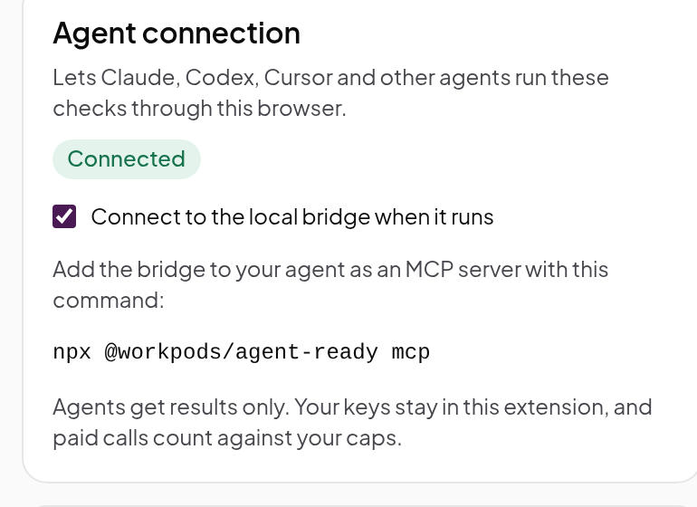

# Agents and skills

Agent Ready gives your coding agent the same checks as the side panel. Two pieces make that work:

- **The bridge** (`@workpods/agent-ready`) is a local MCP server. Your agent starts it, calls its
  tools, and the bridge asks the extension in your Chrome to do the work. With no extension
  connected, the page, site file and crawl checks still run in Node.
- **The skills** are instructions that teach Claude Code or Codex how to run a full audit, a fix
  plan or a keyword study with those tools, and write the results to files in your project.

Nothing goes through a WorkPods server. Your API keys stay in the extension; the agent gets results
only, and every paid call counts against the caps you set in the panel.

## Set up

### 1. Turn on the agent connection



In the side panel, open **Settings**, find **Agent connection** and tick **Connect to the local
bridge when it runs**. The badge shows **Waiting for the bridge** until your agent starts it, then
**Connected**. Keep Chrome open while the agent works.

<br clear="right">

### 2. Add the bridge to your agent

**Claude Code**, with the skills (recommended):

```text
/plugin marketplace add kannumehta/workpods-open-agent-ready
/plugin install agent-ready@agent-ready
```

The plugin starts the bridge for you. To add only the tools, without the skills:

```bash
claude mcp add agent-ready -- npx -y @workpods/agent-ready mcp
```

**Codex:** add this to `~/.codex/config.toml`, and copy `plugin/skills/*` into `~/.codex/skills/`.

```toml
[mcp_servers.agent-ready]
command = "npx"
args = ["-y", "@workpods/agent-ready", "mcp"]
# A crawl of 200 pages can take several minutes.
tool_timeout_sec = 1800
```

**Cursor, Claude Desktop and other MCP clients:** add the server to the client's MCP settings
(`~/.cursor/mcp.json` for Cursor, `claude_desktop_config.json` for Claude Desktop):

```json
{
  "mcpServers": {
    "agent-ready": {
      "command": "npx",
      "args": ["-y", "@workpods/agent-ready", "mcp"]
    }
  }
}
```

### Before the npm release

Until `@workpods/agent-ready` is on npm, run the bridge from a clone of this repository (Node 22 or
later):

```bash
git clone https://github.com/kannumehta/workpods-open-agent-ready.git
cd workpods-open-agent-ready
npm install && npm run build -w bridge
```

Then use `node /full/path/to/workpods-open-agent-ready/bridge/dist/cli.js mcp` wherever the steps
above say `npx -y @workpods/agent-ready mcp`. For Claude Code:

```bash
claude mcp add agent-ready -- node /full/path/to/workpods-open-agent-ready/bridge/dist/cli.js mcp
```

## The skills

Ask in plain words; the agent picks the skill. In Claude Code you can also call one by name, such
as `/agent-ready:site-audit`. Each skill writes its results under `./agent-ready/<skill>/<date>/`
in your project, so you can commit them, diff them and come back to them.

| Skill                    | Try asking                                                       | Needs                                                              |
| ------------------------ | ---------------------------------------------------------------- | ------------------------------------------------------------------ |
| `site-audit`             | "Audit example.com for SEO, GEO and AI agents"                   | Nothing. The extension adds the rendered-page checks               |
| `fix-plan`               | "Fix the high-severity findings from the audit in this repo"     | Your site's code                                                   |
| `build-agent-ready-site` | "Make this Next.js site agent ready and add a CI check"          | Your site's code                                                   |
| `keyword-research`       | "Which keywords should our pricing and comparison pages target?" | DataForSEO in the extension, or your own Search Console MCP server |
| `ai-visibility`          | "How often does ChatGPT recommend us against Acme and Globex?"   | The extension. A Cloro key for unattended runs                     |
| `competitor-gap`         | "Why does acme.com outrank our pricing page?"                    | The extension. DataForSEO for keyword and link gaps                |
| `agent-journeys`         | "Can an AI agent book a demo on our site?"                       | The extension                                                      |

**A typical loop:** run `site-audit` on your money pages, read the report, then ask for
`fix-plan`. The agent makes the code changes with your agreement, and after you deploy it runs each
check again to confirm the fix.

**Search Console:** Agent Ready doesn't connect to Google Search Console. If you add a Search
Console MCP server to your agent yourself, `keyword-research` uses it for real clicks,
impressions and positions: striking-distance keywords, cannibalisation and decay.

**Journeys from your agent** cost nothing extra: your agent is the model. It calls
`journey_observe` to see the page as an agent would, then `journey_act` for each step. The
extension enforces the same rules as the panel: no form is sent, nothing is bought, nobody signs
in, and the journey ends after 15 steps.

## The tools

Skills call these tools for you; you can also ask your agent to call one directly.

| Tool                | What it does                                                                                | Without the extension         |
| ------------------- | ------------------------------------------------------------------------------------------- | ----------------------------- |
| `audit_page`        | Runs every on-page SEO, GEO and AXO check on a URL                                          | Runs; browser checks untested |
| `crawl_site`        | Crawls the site politely and runs the cross-page checks                                     | Runs                          |
| `site_files`        | Checks robots.txt, AI crawler access, sitemaps, llms.txt and agent manifests                | Runs                          |
| `see_as_agent`      | Returns the raw HTML, the rendered text, the accessibility tree and the page's WebMCP tools | Needs the extension           |
| `compare_pages`     | Compares two pages check by check                                                           | Needs the extension           |
| `read_ai_answer`    | Reads the AI answer open in a Chrome tab: brands named and sources cited                    | Needs the extension           |
| `keyword_ideas`     | Keyword ideas with volume, difficulty and intent (DataForSEO)                               | Needs the extension           |
| `keyword_gap`       | Keywords competitors rank for and you don't (DataForSEO)                                    | Needs the extension           |
| `backlinks_summary` | Domain rank, referring domains and backlinks for a domain (DataForSEO)                      | Needs the extension           |
| `link_gap`          | Domains that link to competitors and not to you (DataForSEO)                                | Needs the extension           |
| `journey_observe`   | Starts or continues an agent journey and returns what the agent sees                        | Needs the extension           |
| `journey_act`       | Takes one step in a journey, under the never-submit rules                                   | Needs the extension           |

The paid tools use the cache first: asking the same question again within the reuse window (7
days by default) costs nothing.

## Troubleshooting

| Problem                                      | Fix                                                                                                                                        |
| -------------------------------------------- | ------------------------------------------------------------------------------------------------------------------------------------------ |
| The agent says the extension isn't connected | Open Chrome, tick **Connect to the local bridge when it runs** in Settings, and check that the badge says **Connected**.                   |
| "Port 47821 is in use"                       | Another agent session already runs a bridge. Only one bridge can talk to the extension at a time; close the other session or ask that one. |
| A paid tool is refused                       | Unlock the vault in the side panel, check the provider's key, and set a monthly cap. See [Keys and spending](keys-and-spending.md).        |
| A crawl times out in Codex                   | Raise `tool_timeout_sec` in `~/.codex/config.toml`.                                                                                        |

## Firefox bridge origin

Firefox assigns a different extension origin to each installation. Copy the command shown in
**Settings → Agent connection** in the Firefox extension. Set `AGENT_READY_EXTENSION_ORIGIN` to
that exact `moz-extension://…` origin in your MCP server's environment when configuring an agent.
The bridge accepts only that origin; wildcard or ordinary website origins are rejected. Restart
the bridge after changing its environment. Use the updated bridge source from this repository;
the npm package is not yet published.

For example, an MCP server entry can use the existing bridge command and arguments, plus:

```json
{
  "env": {
    "AGENT_READY_EXTENSION_ORIGIN": "moz-extension://YOUR-INSTALLATION-UUID"
  }
}
```

Replace the placeholder with the exact origin shown in Settings. A bridge process serves one
browser origin at a time; stop the Chrome bridge before starting one for Firefox.
