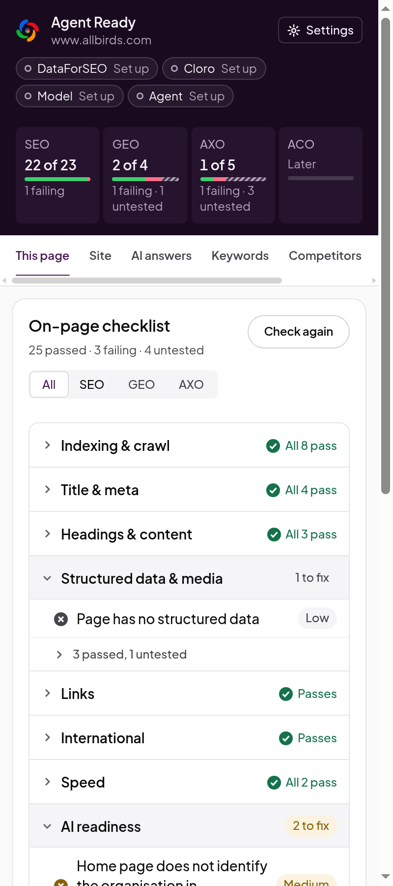

# Getting started

This guide takes you from installing Agent Ready to your first page check, in about five minutes.
You need Chrome (or another Chromium browser, such as Edge or Brave) on a desktop.

## 1. Install the extension

**From the Chrome Web Store:** coming at launch.

**From a release build (today):**

1. Download the newest `agent-ready-<version>-chrome.zip` from this repository's Releases page.
2. Unzip it into a folder you will keep, such as `~/agent-ready`. Chrome loads the extension from
   that folder every time it starts, so don't delete it.
3. Go to `chrome://extensions` and turn on **Developer mode** (top right).
4. Click **Load unpacked** and choose the folder.

To update, unzip the new build over the same folder and click the reload arrow on the extension's
card. Your settings, keys and results are kept, because the extension id never changes.

## 2. Open the side panel

Pin Agent Ready from the puzzle-piece menu in the toolbar, then click its icon. The panel opens on
the right and stays open as you browse.

The first time, the panel asks to **Let the panel follow your tabs**. Click **Allow**. Chrome hides
the address of the page in front of you from extensions unless you allow this, and the panel needs
it to know which page to check.

## 3. Check a page

Go to any page on your site and click **Check this page**. Chrome asks once for each site to let
Agent Ready read it. The extension fetches the page again on its own, to see the raw HTML and
headers that a crawler gets, and reads the page as rendered in your tab.

A check takes a few seconds. Then you see:

- **The score strip** at the top: one score each for SEO, GEO and AXO, such as "19 of 23", with
  how many checks fail and how many are untested. ACO (agentic commerce) is marked for later.
- **The on-page checklist:** every check in eight groups. A group with problems opens on its own
  and says how many to fix. Passed and untested checks fold away under a line such as "5 passed".

Click a failing check to read what was found. Two buttons help you fix it:

- **Show on page** scrolls to the element and outlines it, when the problem is on one element.
- **Copy fix** copies a prompt you can paste into Claude Code, Codex, Cursor or another coding
  agent. It names the check, the page, the evidence and what a fix must do.

Click **SEO**, **GEO** or **AXO** in the score strip to see only that layer's checks, with the
question the layer answers. Click it again to see all checks.

 

## 4. Where to go next

- **Check the whole site:** open the **Site** tab, add your most important pages under **Money
  pages** and click **Start crawl**. See [Using the extension](using-the-extension.md#site).
- **See what AI assistants say about you:** open ChatGPT or Perplexity, ask a question a buyer
  would ask, and open the **AI answers** tab. See [Using the extension](using-the-extension.md#ai-answers).
- **Find out if an agent can use your site:** open **Journeys**. See
  [Using the extension](using-the-extension.md#journeys).
- **Let your coding agent do the work:** see [Agents and skills](agents-and-skills.md).
- **Add paid data:** see [Keys and spending](keys-and-spending.md).

## If something goes wrong

| What you see                      | What to do                                                                                                                               |
| --------------------------------- | ---------------------------------------------------------------------------------------------------------------------------------------- |
| "Open a web page to check it"     | The tab shows a Chrome page (a new tab, settings or the Web Store). Extensions can't read those. Open a normal web page.                 |
| The panel shows the wrong page    | You didn't allow **Let the panel follow your tabs**. Click **Allow** on that prompt, or reopen the panel.                                |
| Every check on a page is untested | The page didn't load, or you declined the site permission. Click **Check again** and allow access when Chrome asks.                      |
| A verdict looks wrong             | Open an issue with the URL, the check's name and a screenshot of the panel. Exports (Markdown or JSON, at the bottom of This page) help. |
