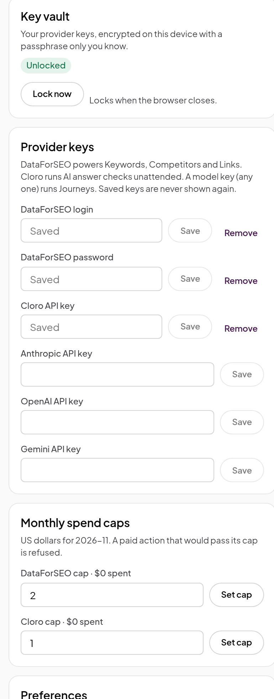

# Keys and spending

Everything on the free side of Agent Ready works with no keys. Add a key when you want data the
extension can't read from a page: search volumes, backlinks, unattended AI answer runs or a model
for journeys. You pay the provider directly, from your own account; Agent Ready takes nothing.

| Provider                        | What it unlocks                                                               | Where to get a key                                               |
| ------------------------------- | ----------------------------------------------------------------------------- | ---------------------------------------------------------------- |
| **DataForSEO**                  | Keyword ideas, top-10 strength, competitors, keyword gap, backlinks, link gap | [dataforseo.com](https://dataforseo.com): API login and password |
| **Cloro**                       | Prompt panels run unattended on ChatGPT, Gemini and Google AI Mode            | [cloro.dev](https://cloro.dev): API key                          |
| **Anthropic, OpenAI or Gemini** | A model for journeys you run from the panel. Any one is enough                | The provider's console                                           |

## 1. Set up the vault

Keys live in an encrypted vault on your device. Open **Settings** and, under **Key vault**, choose
a passphrase of at least 8 characters, then click **Set up the vault**.

- Your passphrase never leaves the extension, and there is no way to recover it. If you forget it,
  use **Wipe data** and add your keys again.
- You unlock the vault once per browser session. It locks again when Chrome closes.
- **Remember on this device** skips the passphrase on this computer. It protects your keys from
  someone who copies your browser files, but not from malware running on the computer. Leave it off
  on a shared machine.

## 2. Add your keys

Under **Provider keys**, paste each key and click **Save**. A saved key is never shown again, even
to you; to change it, save a new one over it. The connection chips in the header turn on as keys
are added.

## 3. Set a monthly cap

Under **Monthly spend caps**, set a limit in US dollars for DataForSEO and for Cloro. A paid
action is refused until its provider has a cap, so you always decide the most you can spend. The
card shows what you have spent this month. Caps reset at the start of each month.

Model keys for journeys have no cap in the panel. Set a spending limit in the provider's own
console if you want one.

 

## How paid actions work

- Every paid button shows its estimated cost before you click it, from the provider's published
  prices.
- An action that would take you over the cap is refused, and the panel tells you why and links to
  the setting to change.
- Answers are cached on your device. Asking the same question again within the reuse window costs
  nothing. Change the window under **Preferences**, **Reuse paid answers for (days)**; it is 7 days
  by default.
- Agents calling the paid tools through the bridge spend from the same caps and cache.

If a provider rejects a call, the panel says why in plain words: your credentials were not
accepted, the account has no access to that data (DataForSEO Backlinks is a separate
subscription), or the balance can't pay for it.

## Wipe data

**Wipe data** in Settings deletes the vault, your keys, caps, saved results and cached answers from
this browser. Use it before you hand the computer on, or if you forget your passphrase.
