# Using the extension

The side panel has a header and seven tabs. This guide goes through them in order. Each section
says what the tab is for, what it costs and how to get the most from it.

The screenshots show real results for allbirds.com, taken on 2 November 2026. Allbirds is only an
example; it has no connection with Agent Ready or WorkPods.

## The header

- **Settings** (top right) opens the vault, your keys, spend caps, preferences and the agent
  connection. See [Keys and spending](keys-and-spending.md).
- **Connection chips** show whether DataForSEO, Cloro, a model key and the agent bridge are set up.
  A green dot means ready. Click a chip to go straight to its setting.
- **The score strip** shows the SEO, GEO and AXO scores for the open page. Each is a button: click
  it to see only that layer's checks. [How the checks work](how-checks-work.md) explains the
  numbers.

## This page

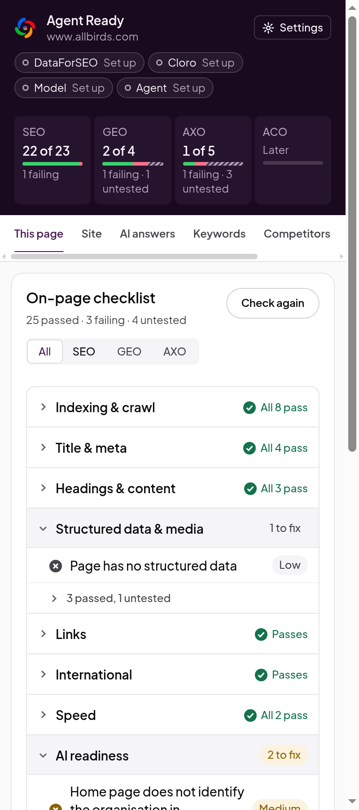

The tab you will use most. Click **Check this page** on any page, and **Check again** after you
change something.

**The on-page checklist** groups every check under one of eight headings: Indexing and crawl,
Title and meta, Headings and content, Structured data and media, Links, International, Speed and
AI readiness. A heading with problems opens on its own and says how many to fix. Passed and
untested checks fold away under a line such as "3 passed, 1 untested".

Use the **All / SEO / GEO / AXO** control, or click a score in the header, to narrow the list to one
layer.

 

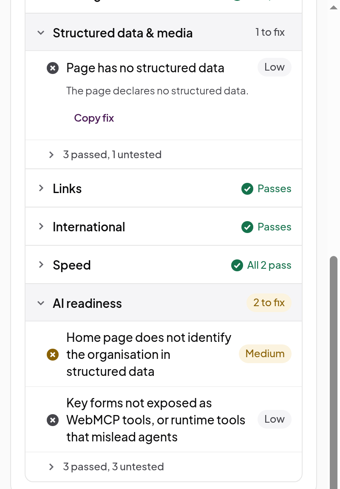

Open a failing check to see what was found. Two buttons help you fix it:

- **Show on page** scrolls the page to the element and outlines it, when the problem is on one
  element.
- **Copy fix** copies a prompt for your coding agent: the check, the page, the evidence and what a
  fix must do.

A good habit: fix the high-severity checks first, paste each **Copy fix** prompt into your coding
agent, deploy, then click **Check again** to confirm.

 

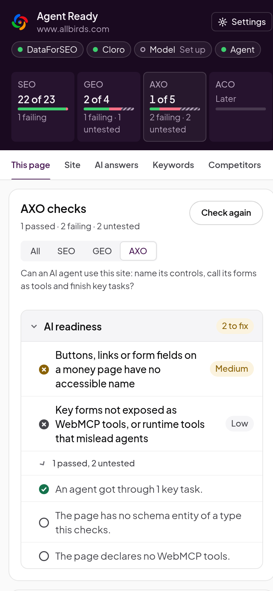

**One layer at a time.** Here is the AXO view for allbirds.com. Two checks fail: some buttons and
fields have no accessible name, and key forms aren't exposed as WebMCP tools. One passes, because an
agent journey on the site found a price. Two are untested, because the page has no schema entity
of a type the check covers and declares no WebMCP tools of its own.

 

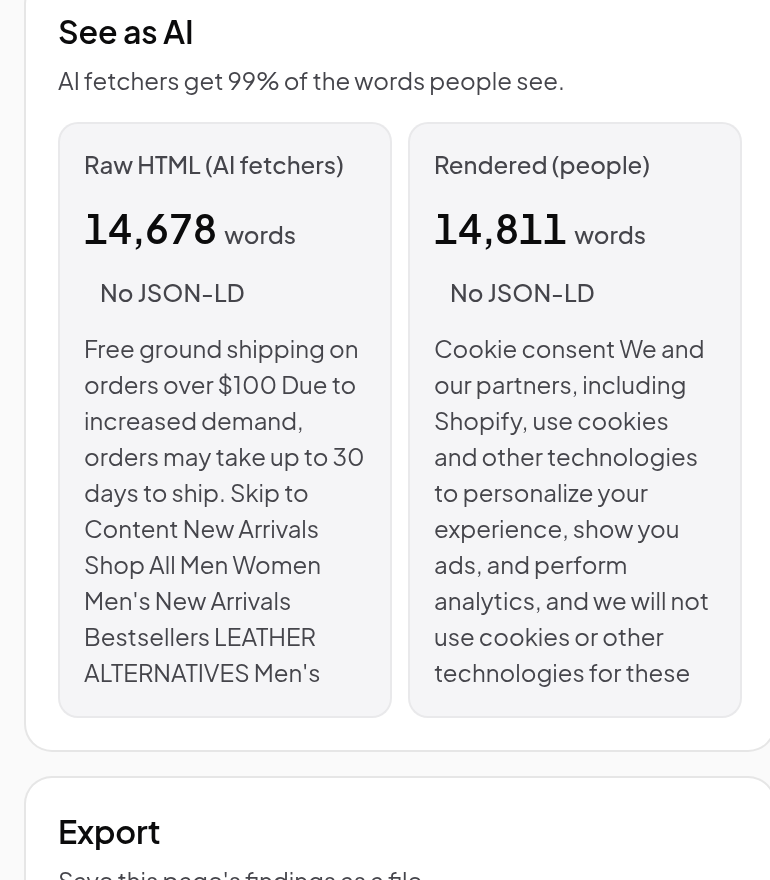

**See as AI** sits below the checklist. On the left is the raw HTML that AI crawlers and answer
engines fetch, without running JavaScript. On the right is the rendered page that people see. Each
side shows its word count, the schema.org types it declares and its opening text. When the left
side has far fewer words, AI answers can't read most of your page, and the checks
`ai_content_requires_js` and `schema_requires_js` say so. On allbirds.com, AI fetchers get 99% of
the words.

**Export** saves the page's findings as Markdown (for a ticket or a pull request), JSON (for
scripts) or CSV (for a spreadsheet).

 

## Site

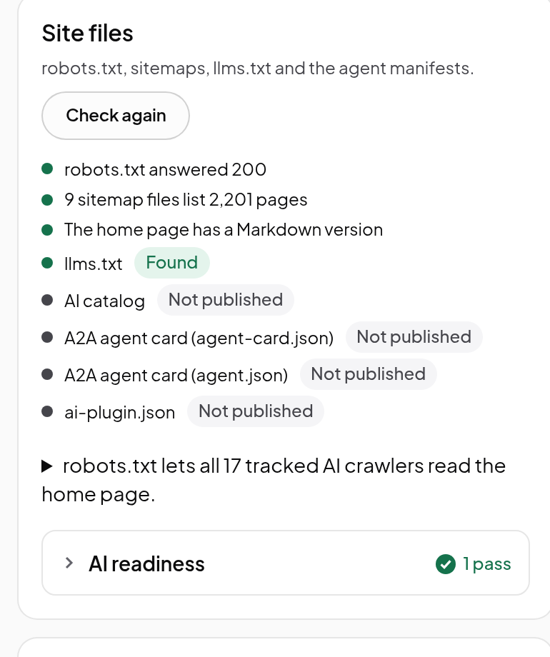

**Site files** checks the files that tell crawlers and agents about your site:

- **robots.txt:** whether each AI crawler may fetch your home page, grouped by what it does
  (training, search index or fetching for a user), plus any Content-Signal lines. Open the line
  under the list to see every crawler.
- **Sitemaps:** whether they can be read and how many URLs they list.
- **llms.txt and agent manifests:** whether you publish them. These are optional, so a missing
  file is untested rather than a failure.

 

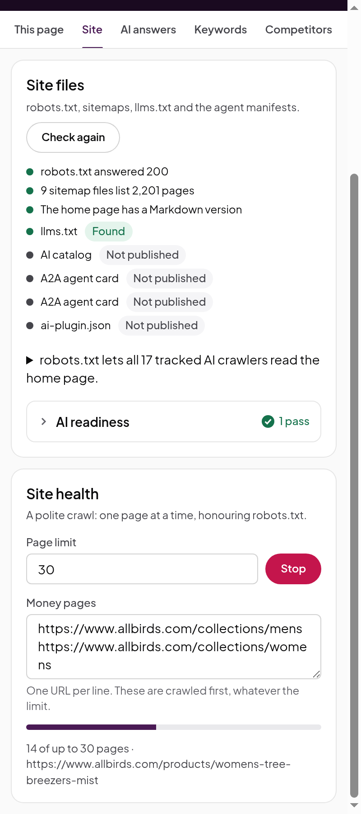

**Site health** crawls your site, starting from the open page, your sitemap and the pages you list
under **Money pages** (your pricing, product and sign-up pages, one URL per line). Money pages are
crawled first, whatever the limit. It fetches one page at a time with a pause between them, follows
robots.txt, and stops at the **Page limit** (200 by default). Click **Stop** at any time; you keep
what was crawled.

Chrome asks for permission to read the site when the crawl starts.

 

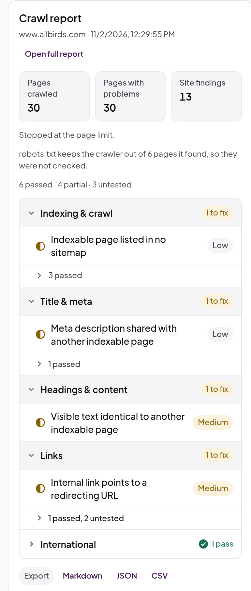

When it finishes, the **Crawl report** shows the pages crawled, the pages with problems and the
site-wide findings: duplicate titles and content, broken links, links to redirects, orphan and deep
pages, sitemap errors, soft 404s and hreflang pairs that don't link back. It also says how many
pages robots.txt kept the crawler out of.

 

**Open full report** opens the same results in a browser tab, with a table of every page and the
problems on each. The report is kept until the next crawl.

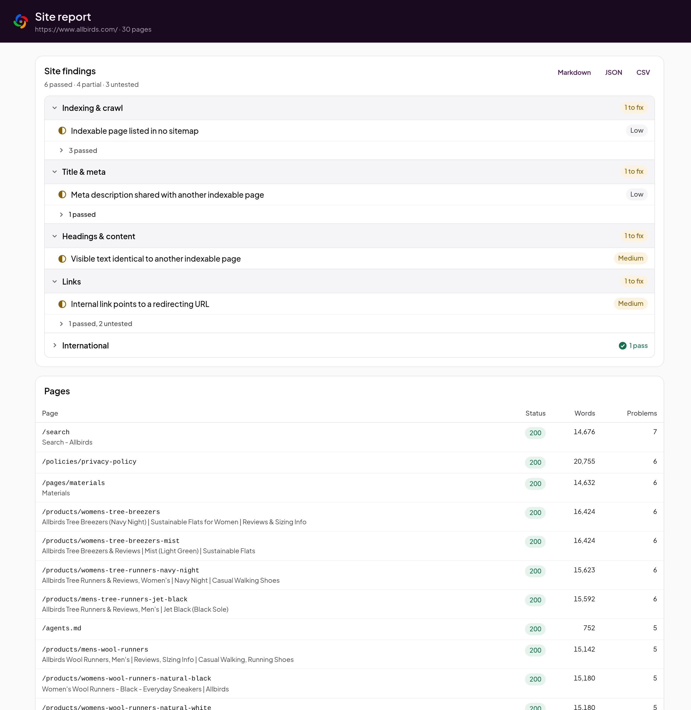

## AI answers

This tab shows what AI assistants say about you and your competitors.

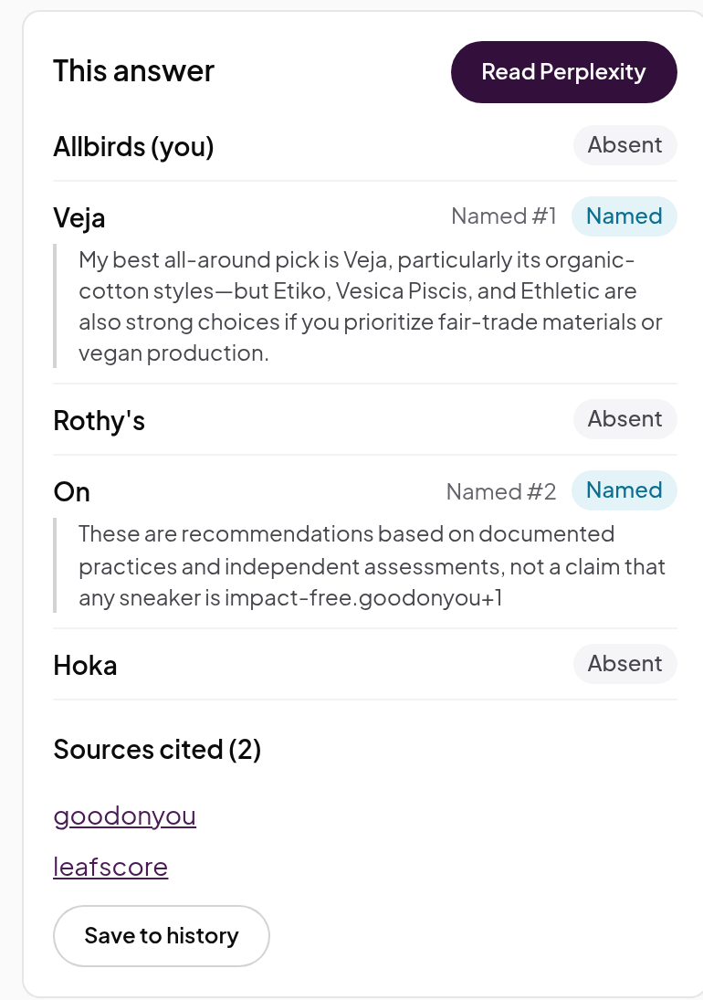

**This answer** reads the AI answer open in your current tab, on ChatGPT, Gemini, Claude,
Perplexity, Google AI Mode or a Google AI Overview. It lists the brands the answer names, in order,
with the passage around each, and the sites it cites. It reads the answer in your own signed-in
session and changes nothing.

Here Perplexity was asked "What are the best sustainable sneakers?". It named Veja first and On
second, and didn't mention Allbirds.

 

**Prompt panel** is a saved set of 5 to 20 questions a buyer would ask, such as "best wool sneakers
for travel". Fill in:

- **Your brand** and **other names for it** (product names, abbreviations, an old name);
- **Your sites**, so citations of your pages count;
- **Competitors**, one per line: the name, then their sites;
- **Prompts**, one per line.

Click **Save panel**. The panel stays on this device.

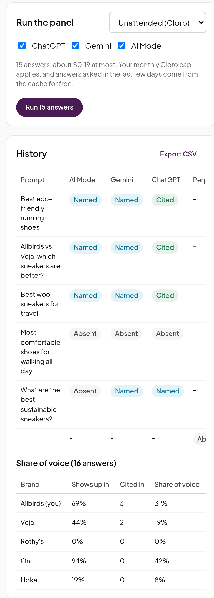

**Run the panel** has two modes:

- **Assist (free):** open the assistant in a tab. For each prompt, click **Fill**: the extension
  types it into the chat box, and you press Enter. It never sends a prompt itself. When the answer
  arrives, it is scored and saved.
- **Unattended (Cloro):** runs every prompt on ChatGPT, Gemini and Google AI Mode through your Cloro
  account. Untick an engine to skip it. The panel shows the number of answers and the most it will
  cost before you start, and the run counts against your Cloro cap.

Each answer is scored for your brand as **Named**, **Cited** or **Absent**. **History** keeps every
answer by prompt and engine, shows your share of voice against each competitor, and exports a CSV.
Run the same panel every week or two to see the trend.

 

## Keywords

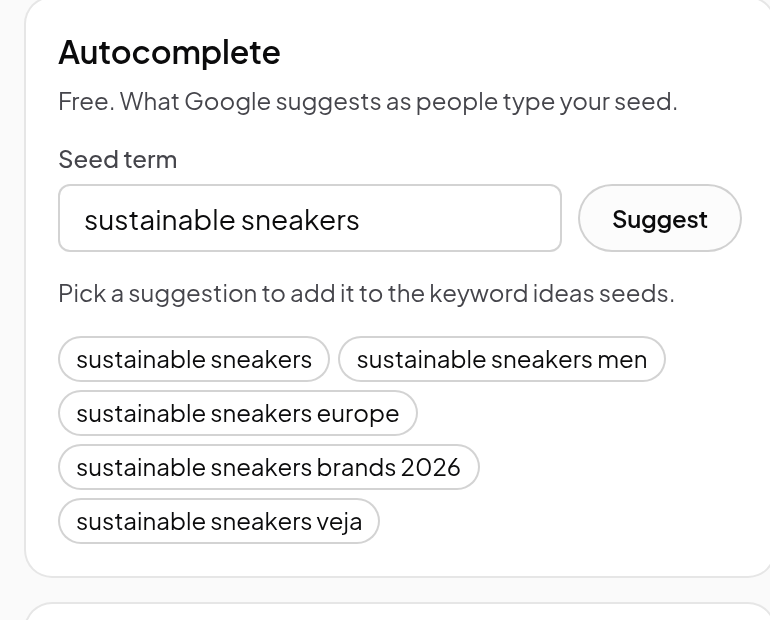

**Free:**

- **Autocomplete:** type a seed term and click **Suggest** to see what Google suggests as people
  type it. Pick a suggestion to add it to your seeds.
- **Results page reader:** open a Google results page in your tab and this card reads the People
  also ask questions, the related searches, the AI Overview (if there is one) and the top 10
  results. Click **This page** or **Compare** on any result to check it or compare it with yours.

 

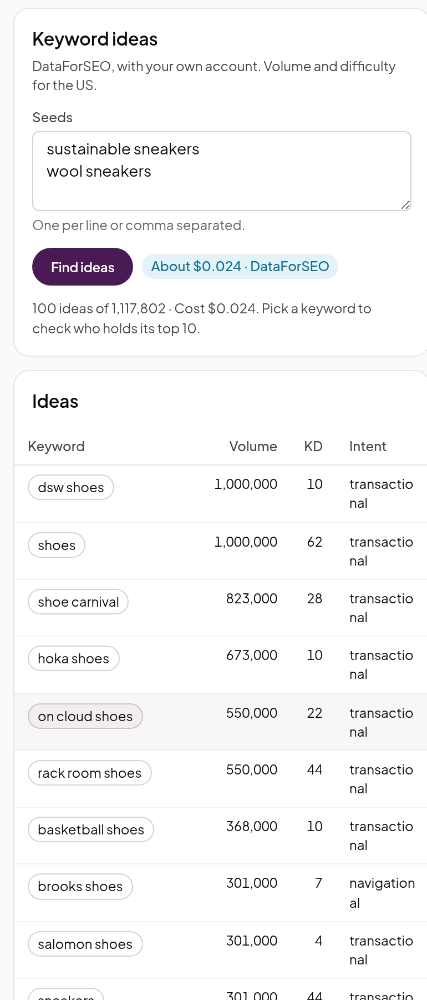

**With DataForSEO:**

- **Keyword ideas:** enter seeds and click **Find ideas** for related keywords with US search
  volume, keyword difficulty (KD) and intent. The button shows the cost before you click.
- **Check the top 10:** pick a keyword to see the domains ranking in its top 10 and how strong they
  are. A low KD can hide a results page held by strong domains; when it does, the keyword is marked
  **Harder than KD says**. Check this before you call a keyword easy.

 

## Competitors

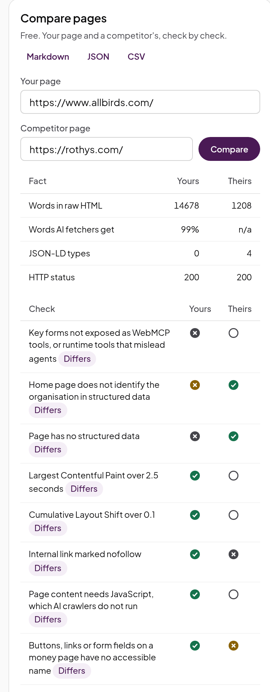

**Compare pages (free)** puts your page and a competitor's side by side: words in the raw HTML,
the share AI fetchers get, JSON-LD types, status, then every check, with the ones that differ
marked. Use it on the page that outranks yours, or the one an AI answer cites instead of yours.
Export the comparison as Markdown, JSON or CSV.

 

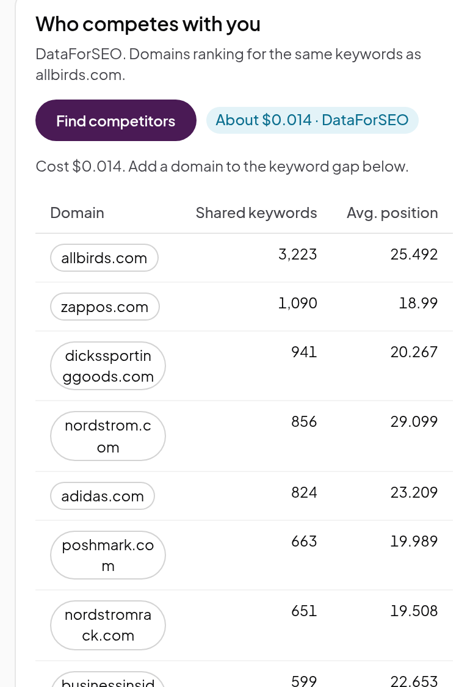

**Who competes with you (DataForSEO)** lists the domains that rank for the same keywords as you,
with the number of keywords you share and their average position. They are often not the brands
you think of: for allbirds.com, the closest are retailers like Zappos and Nordstrom. Click a domain
to add it to the keyword gap.

 

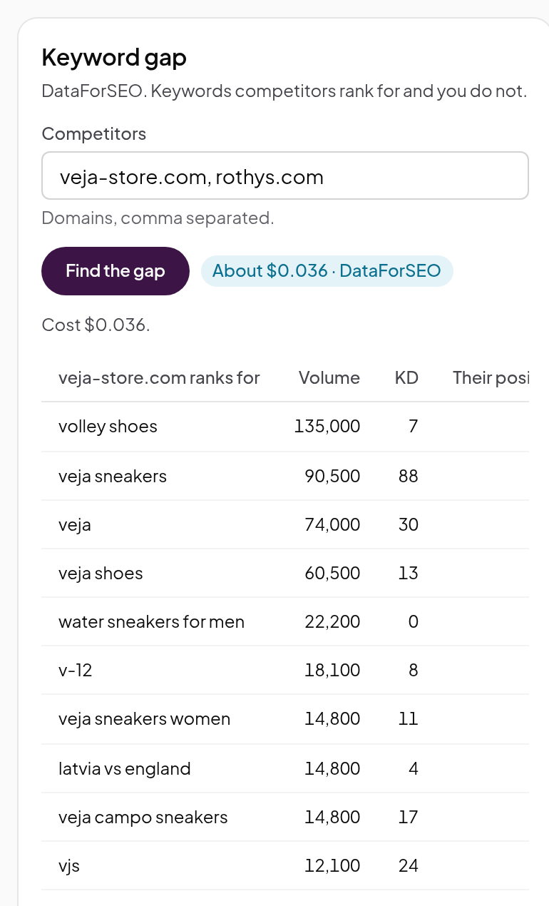

**Keyword gap (DataForSEO)** lists the keywords each competitor ranks for and you don't, with
volume, KD and their position. Each is a candidate for a new page or a better one.

 

## Links

All but the last card use DataForSEO Backlinks, which DataForSEO sells as its own subscription.
If your account doesn't have it, the panel says so.

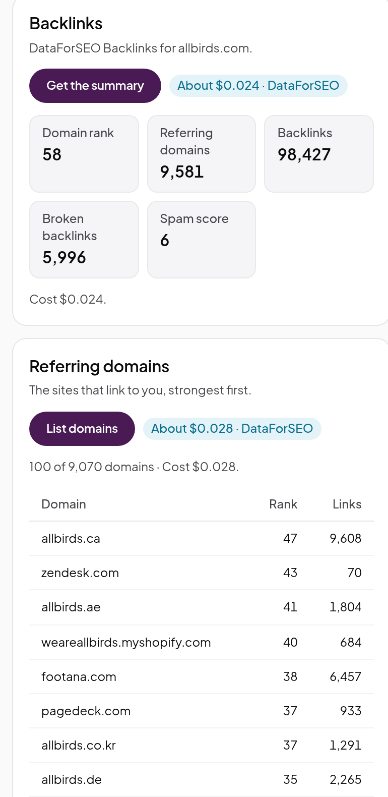

- **Backlinks:** a summary for your domain: domain rank, referring domains, backlinks, broken
  backlinks and spam score.
- **Referring domains:** the sites that link to you, strongest first, with how many links each
  sends.

 

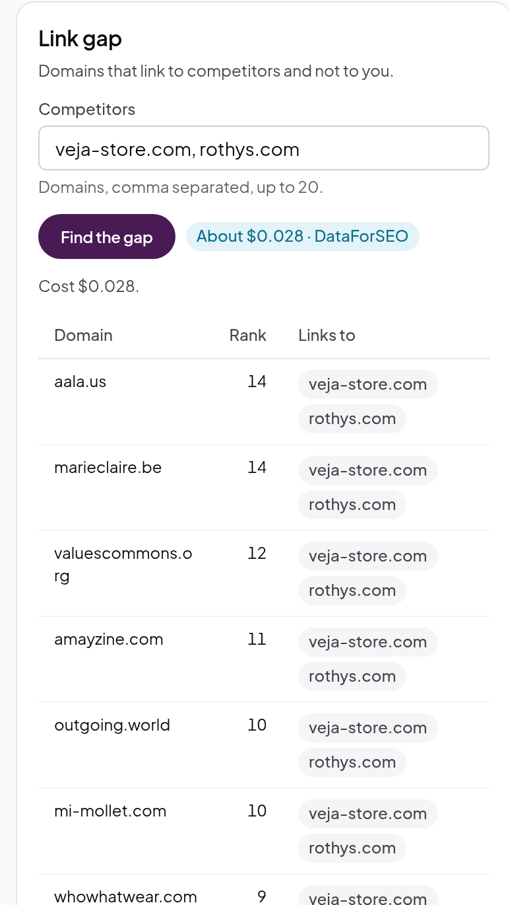

- **Link gap:** domains that link to your competitors and not to you, and which competitors each
  one links to. A domain that links to several of them is the best one to pitch.
- **Broken pages (free):** pages your last crawl found broken. Links pointing at them are wasted;
  redirect each one to the closest live page.

 

## Journeys

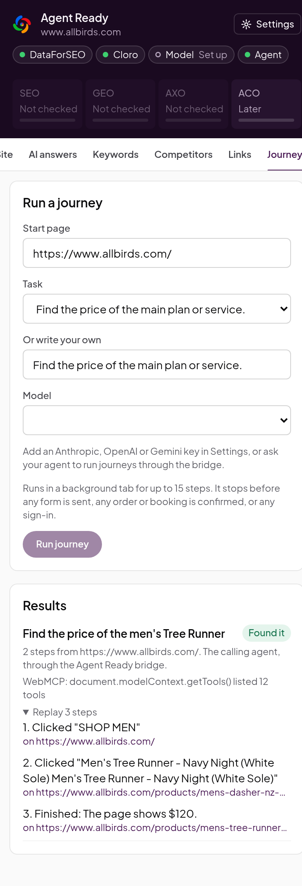

A journey sends an AI agent to your site with a task, such as "Find the price of the main plan or
service", and records where it gets stuck. It is the most direct test of AXO.

1. Enter the **Start page**.
2. Pick a **Task**, or write your own. Choose the tasks your buyers do: find a price, check
   availability, start a booking, find support.
3. Pick a **Model** and click **Run journey**. The list shows a model for each Anthropic, OpenAI or
   Gemini key you saved in Settings, plus **Chrome built-in model (free)** when your Chrome has
   one. The built-in model is small, so expect it to give up sooner than the others.

The agent works in a background tab for up to 15 steps. It reads the page's accessibility tree and
visible text, as an agent in a browser would. It stops before any form is sent, any order or
booking is confirmed, or any sign-in, so it never changes anything on your site.

 

Each result is one of:

- **Found it:** it found what the task asked for.
- **Reached the final step:** it got as far as the last step and stopped there on purpose. For a
  booking or a purchase, this counts as success.
- **Partial:** it made progress but didn't finish.
- **Blocked:** it couldn't go on, for example because a control had no name or the content needed
  a sign-in.
- **Stopped by the safety rules:** the next step would have sent a form or bought something.

Open **Replay** under a result to see every step and the page it was on. The result also feeds the
AXO score on This page: the agent journeys check (AX1) fails when a task ends partial or blocked.
The journey in the screenshot ran through the bridge tools, the way a coding agent runs one. That
needs no model key, because the calling agent is the model. See
[Agents and skills](agents-and-skills.md).
